<picture>
  <source media="(prefers-color-scheme: dark)" srcset="assets/header-dark.svg">
  
</picture>

Full stack & AI engineer at UpYourBizz, France. An eternal student, in service since 2022.

Problem before tool. Production, not demo. Measure before tuning.

**At work** (private):

- **Reach-Up**: white-label B2B prospecting SaaS. Campaigns orchestrated on a canvas, sequenced across email, LinkedIn, SMS and WhatsApp.
- **Octo**: car-dealership DMS exports in, a report out. Not a dashboard.

**In public:**

- **[loadout](https://github.com/Zokuzo/loadout)**: themes for Claude Code. A mascot per model, subagents on stage, usage meters, a working line.
- **[christopher-nolan](https://github.com/Zokuzo/christopher-nolan)**: your coding agent reads the repo, asks you one question at a time, then renders the video with Remotion.
- **[eternal](https://zokuzo.github.io/eternal/)**: AI-written code, replayed as lessons in a 2D pixel game. (work in progress tbh)

Before that: ML at Sophia Genetics, predicting RAM per bioinformatics pipeline task. The old system over-allocated ~1200 TB in 3 months.

<picture>
  <source media="(prefers-color-scheme: dark)" srcset="assets/rails-dark.svg">
  
</picture>

<picture>
  <source media="(prefers-color-scheme: dark)" srcset="assets/barbell-dark.svg">
  
</picture>

[hugojuskowiak.com](https://hugojuskowiak.com) · [linkedin](https://www.linkedin.com/in/hugo-juskowiak/)
